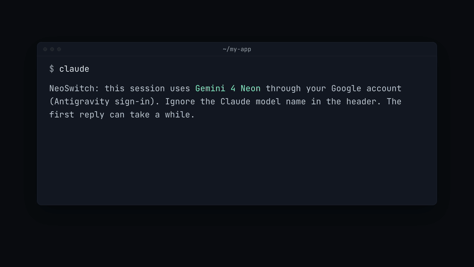

# NeoSwitch

[English](../README.md) | [简体中文](README.zh-CN.md) | [繁體中文](README.zh-TW.md) | [日本語](README.ja.md) | [한국어](README.ko.md) | **Español** | [Français](README.fr.md) | [Deutsch](README.de.md) | [Português (Brasil)](README.pt-BR.md) | [Русский](README.ru.md)

[](https://github.com/yldm-ai/neo-switch/blob/main/.claude-plugin/plugin.json) [](https://github.com/yldm-ai/neo-switch/blob/main/LICENSE)

NeoSwitch hace que Claude Code responda con el modelo Gemini 4 Neon de Google en lugar de Claude, mientras todo lo demás en Claude Code sigue igual.

[](../docs/media/neoswitch-demo.mp4)

Cambias un proyecto cada vez; tus demás proyectos siguen usando Claude. El plugin funciona en macOS y Linux. Windows todavía no es compatible.

## Primeros pasos

**1. Instala el plugin.** En Claude Code, ejecuta estas dos líneas una por una. Copia cada línea entera: la primera dice `neo-switch` y la segunda `neoswitch`.

```text
/plugin marketplace add yldm-ai/neo-switch
```

```text
/plugin install neoswitch@neoswitch
```

**2. Inicia sesión con tu cuenta de Google.** Abre Claude Code en el proyecto que quieres cambiar y ejecuta:

```text
/neoswitch:login
```

Muestra la advertencia sobre los términos de Google, abre el inicio de sesión de Google en tu navegador a través de la [herramienta de línea de comandos Antigravity de Google (`agy`)](https://antigravity.google/download), que debe estar instalada en este ordenador, y después cambia el proyecto. Si te manejas bien con la terminal, también sirve una clave de API de Gemini: consulta [docs/cli.md](../docs/cli.md#gemini-api-key) (en inglés).

> [!WARNING]
> Los [Términos de Servicio de Google Antigravity](https://antigravity.google/terms) (sección 6) prohíben usar Antigravity a través de otras herramientas, y NeoSwitch es una de ellas. Google puede suspender o cerrar las cuentas de Antigravity de quienes lo hagan. `/neoswitch:login` repite esta advertencia cada vez. No inicies sesión si no aceptas ese riesgo.

**3. Envía tu siguiente mensaje.** La ventana donde ejecutaste el comando usa Gemini 4 Neon desde su siguiente mensaje, igual que las sesiones nuevas de este proyecto. Si la respuesta del comando te pide reiniciar, porque Claude Code se inició a través de un gateway o porque otras ventanas de Claude Code aún usan una configuración anterior de NeoSwitch, cierra las ventanas que indique y vuelve a iniciar `claude` en el mismo proyecto.

## Qué verás

- La nueva sesión empieza con un aviso como `NeoSwitch: this session uses Gemini 4 Neon through your Google account (Antigravity sign-in). Ignore the Claude model name in the header. The first reply can take a while.`
- La cabecera sigue mostrando un nombre de modelo de Claude, como `claude-opus-5-5`. Es solo una etiqueta: responde Gemini 4 Neon. Elegir otro modelo con `/model` no cambia eso.
- Una respuesta puede tardar de 5 a 40 segundos en mostrar sus primeras palabras. Es normal. Si iniciaste sesión con `/neoswitch:login`, `/effort low` hace que las respuestas empiecen antes.
- El primer comando de NeoSwitch tras instalar o actualizar puede tardar hasta un minuto mientras NeoSwitch se prepara.
- `/neoswitch:status` te dice en cualquier momento si esta sesión usa Claude o Gemini 4 Neon, y qué hacer después.

## Si algo falla

| Lo que ves | Qué hacer |
|---|---|
| El aviso de la sesión dice que NeoSwitch aún no está configurado | Ejecuta `/neoswitch:login`. Tu siguiente mensaje usa Gemini 4 Neon. |
| Un mensaje dice que `agy` no está instalado | Instala la [herramienta de línea de comandos Antigravity de Google (`agy`)](https://antigravity.google/download) y vuelve a ejecutar `/neoswitch:login`. |
| Todos los mensajes fallan con un error de conexión, o el aviso de la sesión dice que esta sesión no puede responder | En este mismo proyecto, ejecuta `/neoswitch:off`. Cambia el proyecto de vuelta aunque su propia respuesta también muestre un error de conexión. Luego escribe `/exit` y vuelve a iniciar `claude`: estás de nuevo en Claude, y `/neoswitch:status` te dice qué arreglar. |
| El aviso dice que otras ventanas de Claude Code siguen compartiendo la configuración anterior | Cierra todas las ventanas de Claude Code y vuelve a abrir Claude Code. |
| El aviso dice que otro programa está usando el puerto que necesita NeoSwitch | Cierra ese programa y vuelve a iniciar Claude Code, o ejecuta `/neoswitch:off`. |
| El aviso dice que NeoSwitch no pudo descargar su programa | Comprueba tu conexión a internet y vuelve a iniciar Claude Code. |
| `/neoswitch:login` aparece como comando desconocido | Actualiza el plugin (ver abajo), reinicia Claude Code y ejecuta `/reload-plugins`. |

## Desactivar, actualizar o quitar

- `/neoswitch:off` devuelve este proyecto a Claude para las sesiones nuevas; una sesión que ya usa Gemini 4 Neon lo mantiene hasta que escribas `/exit`. `/neoswitch:on` vuelve a cambiar el proyecto a Gemini 4 Neon sin configurar nada de nuevo, a partir de tu siguiente mensaje.

Para actualizar el plugin, ejecuta esto en una terminal y reinicia Claude Code:

```bash
claude plugin marketplace update neoswitch
claude plugin update neoswitch@neoswitch
```

Si añadiste el marketplace con su nombre antiguo `yldm-ai/NeoSwitch` / `yldm-ai/neon-switch`, primero vuelve a añadirlo con `claude plugin marketplace add yldm-ai/neo-switch`.

Para quitar NeoSwitch:

1. Ejecuta primero `/neoswitch:off` en cada proyecto que activaste. Un proyecto que quede activado sigue apuntando a NeoSwitch y deja de responder cuando NeoSwitch ya no está. Si ya quitaste el plugin, abre `.claude/settings.local.json` en cada uno de esos proyectos y borra `ANTHROPIC_BASE_URL`, `ANTHROPIC_AUTH_TOKEN` y `CLAUDE_CODE_USE_GATEWAY` de su objeto `env`.
2. Cierra las ventanas de Claude Code que usan NeoSwitch y ejecuta esto en una terminal:

```bash
claude plugin uninstall neoswitch@neoswitch
claude plugin marketplace remove neoswitch
```

3. Borra los archivos que NeoSwitch guarda fuera de tus proyectos:

| Qué | Dónde |
|---|---|
| El programa NeoSwitch que el plugin descarga o compila | `$XDG_CACHE_HOME/neoswitch/`, o `~/.cache/neoswitch/` si `XDG_CACHE_HOME` no está definido |
| Ajustes y registro: `proxy.json` (dirección, clave de acceso y vía elegida) y `daemon.log` | `NEOSWITCH_STATE_DIR` si está definido; si no, `~/Library/Application Support/neoswitch/` en macOS y `$XDG_CONFIG_HOME/neoswitch/` o `~/.config/neoswitch/` en Linux |

El inicio de sesión de Google lo guarda `agy`, no NeoSwitch, y se queda donde está.

## Qué cambia NeoSwitch

En cada proyecto que activas, NeoSwitch añade tres entradas al objeto `env` de `.claude/settings.local.json`, y `/neoswitch:off` las vuelve a quitar:

- `ANTHROPIC_BASE_URL` y `ANTHROPIC_AUTH_TOKEN` envían las nuevas sesiones de Claude Code del proyecto a NeoSwitch en este ordenador. El token solo abre NeoSwitch en este ordenador; no es una credencial de Google ni de Anthropic.
- `CLAUDE_CODE_USE_GATEWAY=0` hace que esas sesiones hablen directamente con NeoSwitch. Algunas herramientas que inician Claude Code a través de otra pasarela activan el modo pasarela, y entonces Claude Code ignoraría NeoSwitch.

En un proyecto Git, NeoSwitch también añade `.claude/settings.local.json` a la lista de exclusión propia del clon (`.git/info/exclude`), para que el token no entre en los commits; tu `.gitignore` no se toca.

NeoSwitch se ejecuta solo en este ordenador y solo acepta conexiones desde él. No registra prompts, respuestas, claves ni datos de inicio de sesión, y no interviene ningún servidor nuestro. El inicio de sesión de Google se queda dentro de `agy`; NeoSwitch nunca lo lee.

## Más

Qué funciona y qué no, cómo funciona NeoSwitch, la herramienta de línea de comandos independiente, las variables de entorno, la hoja de ruta y el desarrollo: [docs/cli.md](../docs/cli.md) (en inglés). También: [detalles del inicio de sesión de Antigravity](../docs/antigravity.md) y el [contrato del protocolo](../docs/protocol-contract.md).

Consulta [CONTRIBUTING.md](../CONTRIBUTING.md) para contribuir, [SECURITY.md](../SECURITY.md) para informar de una vulnerabilidad en privado y [CODE_OF_CONDUCT.md](../CODE_OF_CONDUCT.md) para el código de conducta.

MIT License
