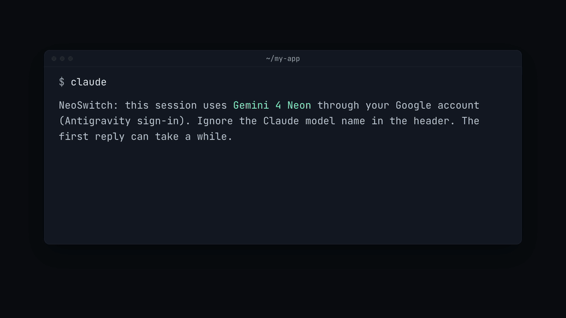

# NeoSwitch

[English](../README.md) | [简体中文](README.zh-CN.md) | **繁體中文** | [日本語](README.ja.md) | [한국어](README.ko.md) | [Español](README.es.md) | [Français](README.fr.md) | [Deutsch](README.de.md) | [Português (Brasil)](README.pt-BR.md) | [Русский](README.ru.md)

[](https://github.com/yldm-ai/neo-switch/blob/main/.claude-plugin/plugin.json) [](https://github.com/yldm-ai/neo-switch/blob/main/LICENSE)

NeoSwitch 讓 Claude Code 改用 Google 的 Gemini 4 Neon 模型來回答，Claude Code 的其他一切照舊。

[](../docs/media/neoswitch-demo.mp4)

開關以專案為單位，你的其他專案繼續使用 Claude。外掛支援 macOS 和 Linux，暫不支援 Windows。

## 三步上手

**1. 安裝外掛。** 在 Claude Code 裡依序執行下面兩行，一次一行。每行請整行複製：第一行寫的是 `neo-switch`，第二行是 `neoswitch`。

```text
/plugin marketplace add yldm-ai/neo-switch
```

```text
/plugin install neoswitch@neoswitch
```

**2. 用你的 Google 帳號登入。** 在要切換的專案裡開啟 Claude Code，執行：

```text
/neoswitch:login
```

它會先顯示 Google 的條款警告，再透過 Google 的 [Antigravity 命令列工具（`agy`）](https://antigravity.google/download)在瀏覽器裡開啟 Google 登入，最後為這個專案開啟 NeoSwitch。這台電腦上需要先裝好 `agy`。如果你習慣用終端機，也可以改用 Gemini API key：見 [docs/cli.md](../docs/cli.md#gemini-api-key)（英文）。

> [!WARNING]
> [Google Antigravity 服務條款](https://antigravity.google/terms)（第 6 條）禁止透過其他工具使用 Antigravity，NeoSwitch 就屬於這類工具。Google 可能暫停或關閉這樣做的人的 Antigravity 和 Gemini CLI 帳號。`/neoswitch:login` 每次都會重複這則警告。不接受這個風險，就不要登入。

**3. 傳送下一則訊息。** 執行指令的那個視窗從下一則訊息起就使用 Gemini 4 Neon，這個專案裡的新工作階段也一樣。如果指令的回覆要你重新啟動（Claude Code 是透過閘道啟動的，或是別的 Claude Code 視窗還在用 NeoSwitch 先前的設定），就關掉它提到的視窗，然後在同一個專案裡重新執行 `claude`。

## 開啟後你會看到

- 新工作階段開頭會出現一則提示，例如 `NeoSwitch: this session uses Gemini 4 Neon through your Google account (Antigravity sign-in). Ignore the Claude model name in the header. The first reply can take a while.`
- 標題列仍然顯示 Claude 的型號名稱，例如 `claude-opus-5-5`。這只是個標籤，實際回答的是 Gemini 4 Neon。用 `/model` 換模型也不會改變這一點。
- 每次回答可能要等 5 到 40 秒才出現第一個字，這是正常的。如果你是用 `/neoswitch:login` 登入的，輸入 `/effort low` 可以讓回答更快開始。
- 安裝或更新後的第一條 NeoSwitch 指令可能要等上一分鐘，NeoSwitch 正在做準備。
- 隨時可以執行 `/neoswitch:status`，它會告訴你目前工作階段用的是 Claude 還是 Gemini 4 Neon，以及下一步該做什麼。

## 出了問題怎麼辦

| 你看到的情況 | 怎麼做 |
|---|---|
| 工作階段開頭的提示說 NeoSwitch 還沒設定好 | 執行 `/neoswitch:login`。下一則訊息就會使用 Gemini 4 Neon。 |
| 提示說沒有安裝 `agy` | 先安裝 Google 的 [Antigravity 命令列工具（`agy`）](https://antigravity.google/download)，再執行一次 `/neoswitch:login`。 |
| 每則訊息都出現連線錯誤，或者工作階段開頭的提示說本工作階段無法回答 | 就在這個專案裡執行 `/neoswitch:off`。即使它自己的回覆也顯示連線錯誤，專案也已經切回去了。然後輸入 `/exit` 並重新執行 `claude`：你回到了 Claude，再執行 `/neoswitch:status` 看看該修什麼。 |
| 提示說其他 Claude Code 視窗還在共用先前的設定 | 關掉所有 Claude Code 視窗，再重新開啟 Claude Code。 |
| 提示說有別的程式佔用了 NeoSwitch 需要的連接埠 | 關掉那個程式後重新啟動 Claude Code，或者執行 `/neoswitch:off`。 |
| 提示說 NeoSwitch 無法下載它的程式 | 檢查網路連線，然後重新啟動 Claude Code。 |
| `/neoswitch:login` 顯示為未知指令 | 更新外掛（見下文），重新啟動 Claude Code，再執行 `/reload-plugins`。 |

## 關閉、更新與移除

- `/neoswitch:off` 讓這個專案的新工作階段切回 Claude；已經在用 Gemini 4 Neon 的工作階段會一直用到你輸入 `/exit`。`/neoswitch:on` 把專案再切回 Gemini 4 Neon，不必重新設定，從下一則訊息開始生效。

更新外掛：在終端機裡執行下面兩條指令，然後重新啟動 Claude Code：

```bash
claude plugin marketplace update neoswitch
claude plugin update neoswitch@neoswitch
```

如果你當初是用舊名稱 `yldm-ai/NeoSwitch` / `yldm-ai/neon-switch` 加入 marketplace，請先執行 `claude plugin marketplace add yldm-ai/neo-switch` 重新加入。

移除 NeoSwitch：

1. 先在每個開啟過的專案裡執行 `/neoswitch:off`。沒有關掉的專案仍然指向 NeoSwitch，移除後就無法回答了。如果已經移除了外掛，請在每個這樣的專案裡打開 `.claude/settings.local.json`，從 `env` 物件中刪掉 `ANTHROPIC_BASE_URL`、`ANTHROPIC_AUTH_TOKEN` 和 `CLAUDE_CODE_USE_GATEWAY`。
2. 關掉正在使用 NeoSwitch 的 Claude Code 視窗，然後在終端機裡執行：

```bash
claude plugin uninstall neoswitch@neoswitch
claude plugin marketplace remove neoswitch
```

3. 刪除 NeoSwitch 保存在專案之外的檔案：

| 內容 | 位置 |
|---|---|
| 外掛下載或編譯出的 NeoSwitch 程式 | `$XDG_CACHE_HOME/neoswitch/`；未設定 `XDG_CACHE_HOME` 時為 `~/.cache/neoswitch/` |
| 設定和日誌：`proxy.json`（位址、存取金鑰和所選方式）和 `daemon.log` | 設定了 `NEOSWITCH_STATE_DIR` 時就是它；否則 macOS 上是 `~/Library/Application Support/neoswitch/`，Linux 上是 `$XDG_CONFIG_HOME/neoswitch/` 或 `~/.config/neoswitch/` |

Google 登入資訊由 `agy` 保存，不歸 NeoSwitch 管，移除後仍然保留。

## NeoSwitch 會改動什麼

在你開啟的每個專案裡，NeoSwitch 會在 `.claude/settings.local.json` 的 `env` 物件中加入三項，`/neoswitch:off` 會把它們刪掉：

- `ANTHROPIC_BASE_URL` 和 `ANTHROPIC_AUTH_TOKEN`：讓這個專案的新 Claude Code 工作階段連到這台電腦上的 NeoSwitch。這個 token 只能用來存取本機的 NeoSwitch，不是 Google 或 Anthropic 的憑證。
- `CLAUDE_CODE_USE_GATEWAY=0`：讓這些工作階段直接連 NeoSwitch。有些工具會透過別的閘道啟動 Claude Code 並開啟閘道模式，那樣 Claude Code 就會忽略 NeoSwitch。

在 Git 專案裡，NeoSwitch 還會把 `.claude/settings.local.json` 加進本機儲存庫自己的排除清單（`.git/info/exclude`），讓這個 token 不會被提交；你的 `.gitignore` 不會被改動。

NeoSwitch 只在這台電腦上執行，也只接受來自這台電腦的連線。它不記錄提示詞、回覆、key 或登入資訊，也不經過我們的任何伺服器。Google 登入資訊留在 `agy` 裡，NeoSwitch 從不讀取。

## 更多

哪些功能可用、哪些不可用，NeoSwitch 的運作方式，獨立命令列工具，環境變數，路線圖和開發說明：見 [docs/cli.md](../docs/cli.md)（英文）。另見 [Antigravity 登入詳情](../docs/antigravity.md)和[協定約定](../docs/protocol-contract.md)。

參與貢獻見 [CONTRIBUTING.md](../CONTRIBUTING.md)，私下回報安全漏洞見 [SECURITY.md](../SECURITY.md)，行為準則見 [CODE_OF_CONDUCT.md](../CODE_OF_CONDUCT.md)。

MIT License
